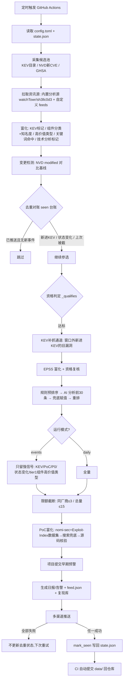

# 漏洞监控流程实现说明

本文档描述 `actions-test`（CVE Daily Monitor v3）漏洞情报监控的实现流程：数据从哪来、怎么筛选加工、怎么去重、怎么推送给用户。代码入口为 `monitor.py`，核心逻辑在 `vulnmon/` 包中，纯 Python 标准库实现，由 GitHub Actions 定时调度，零第三方依赖。

## 一、整体流程总览

```
多源采集 → 富化(KEV/EPSS/PoC/nuclei/组件画像+知名度/高价值类型/技术分析) → 去重与变更检测
→ 资格判定 → 价值排序 → AI 分析(可选,前30条) → 限额截断 → 输出存档(feed/日报/复现库)
→ 多渠道推送(钉钉/飞书/企微/TG/Slack) → 状态写回 state.json → CI 提交回仓库
```

单次运行的完整数据流（`monitor.py` → `vulnmon/pipeline.py`）：



## 二、运行模式与调度

三个 GitHub Actions 工作流（`.github/workflows/`）对应三种推送节奏，共享同一份 `data/state.json` 去重状态：

| 模式 | 工作流 | 频率 | 说明 |
|---|---|---|---|
| `daily`（默认） | `cve-monitor.yml` | 每天 UTC 23:43（北京 07:43，避开 Actions 排队高峰） | 全量价值排序日报，回看 24h |
| `events` | `cve-events.yml` | 每 4 小时（UTC 1/5/9/13/17/21 点 25 分） | 只推强信号（KEV/PoC/P0/状态变化），回看 5h，单次 ≤3 条 |
| `weekly` | `cve-weekly.yml` | 每周一 UTC 01:35 | 聚合 `history.json` 生成周报复盘 |

cron 刻意避开整点和 UTC 0~1 点拥堵带（GitHub 免费版定时任务会排队）。每次运行结束后 CI 把 `data/`（状态、feed、日报、复现库）提交回仓库，既持久化状态，也防止仓库 60 天不活跃被停用定时任务。

## 三、数据采集层（`vulnmon/sources/`）

| 数据源 | 模块 | 作用 |
|---|---|---|
| NVD API 2.0 | `nvd.py` | 新发布 CVE（`pubStartDate` 窗口查询）、变更数据（`lastModStartDate`）、按 ID 补抓 |
| CISA KEV | `kev.py` | 在野利用确认、勒索软件标记、CISA 修复截止日期 |
| GitHub GHSA | `ghsa.py` | 人工审核公告，补包生态/影响版本/修复版本信息 |
| FIRST EPSS | `epss.py` | 未来 30 天被利用概率（只查已入选条目，省配额） |
| Exploit-DB | `exploitdb.py` | CVE → 公开 exploit 映射 |
| PoC-in-GitHub 数据集 | `poc_github.py` | CVE → PoC 仓库映射（带 star），另有 GitHub 搜索兜底与仓库源码核验 |
| Exploit-Index 数据集 | `exploit_index.py` | CVE → PoC 仓库映射（带可信度标注 ✅可信/❓未验证/⚠️存疑）+ Metasploit 模块收录，与 nomi-sec 数据集互补 |
| nuclei-templates | `nuclei.py` | 是否已有公开检测模板（武器化信号） |
| RSS/Atom | `feeds.py` | 内置技术分析源（watchTowr Labs / sh3llc0d3，标题带 CVE 号的作为「有技术分析」信号参与排序）+ 自定义安全媒体资讯 |
| The HackerWire | `vulndb.py` | 详情页自动挂按 CVE 号构造的漏洞新闻聚合链接（免抓取） |
| GitHub Commits | `commits.py` | 监控 55 个重点项目（OpenSSL/若依/Jenkins 等）的安全相关提交，作 CVE 披露前的**早期预警**（按 `repo@sha` 去重） |

采集阶段（`gather_candidates`）以 NVD 新发布为主干，GHSA 合并补位，Exploit-DB 与 nuclei 覆盖直接挂到候选条目上。

## 四、筛选管线（`vulnmon/pipeline.py` 的 `enrich_and_filter`）

这是整个系统的核心，按顺序执行：

### 1. 富化
对每个候选：应用 KEV 标记 → `components.py` 组件分类（边界设备/中间件/CMS/OA 等 15 类）与**知名度分层**（tier1 全网级基础组件 / tier2 常见重点资产）→ **高价值漏洞类型识别**（任意文件读写/RCE/SQL注入/提权）→ 关注关键词匹配（含 "key exchange" 类误报排除）→ 内置分析源点名标记 → 无 CPE 时从参考链接域名推断厂商。

### 2. 变更检测（仅 daily）
拉取窗口内被 NVD 修改的漏洞，与 `state.json` 中记录的基线（cvss、exploit_ref）对比：
- CVSS 变化 ≥ 0.7（升分/降分）或新增公开 PoC 引用 → 产出「状态变化」重推条目
- ±0.1 的微调不刷屏

### 3. 去重对账（`state.json` 的 seen 台账，以 CVE 编号为身份）
- 已推送且无新事件 → 跳过（`dedup_suppressed`）
- 上次达标但被上限截掉（`pushed=False`）→ **重新参选**，不丢情报
- 旧漏洞新入选 KEV → **升级重推**，标「此前已推送，现已确认在野利用」
- 状态变化 → 重推一次

### 4. 资格判定（`_qualifies`，满足其一）
- KEV 在野利用（不受任何门槛限制，必推）
- CVSS ≥ `direct_push_threshold`（9.0）直推
- CVSS ≥ `cvss_threshold`（7.0）且命中强信号：EPSS ≥ 0.1 / 有 PoC / 命中关注词 / **高价值漏洞类型**（任意文件读写、RCE、SQL注入、提权——CVSS 过线即入选，无 PoC 也推）

反向排除：命中 `ignore_keywords` 拉黑词、第三方插件/扩展灌水（通用句式识别，KEV 除外）。

### 5. KEV 补抓通道
不在本次发布窗口内、但 `dateAdded` 落在窗口内（至少回看 7 天）的新进 KEV 漏洞，按 CVE 号逐个补抓 NVD 详情（限 15 个，防 NVD 限流超时），保证在野利用漏洞不被 24h 窗口卡死。

### 6. EPSS 复核
只对入选条目查 EPSS（省配额）；高 EPSS 是补强信号可救回条目，同时会复核把"分数不够、又无任何强信号"的条目剔掉。

### 7. AI 分析参与排序
先按规则分预排序 → 前 `ai_analyze_limit`（30）条送 LLM 逐条分析（产出优先级 P0/P1/P2、复现价值、中文标题/摘要/处置建议）→ 未进池或 AI 漏答的用确定性兜底规则赋值 → **带 AI 结果重排**决定最终入选。AI 判定直接参与排序，但不守门——筛选门槛始终由规则引擎把守，LLM 失败自动降级，管道不因 AI 挂掉。

### 8. events 强信号过滤 + 限额截断
- events 模式再过滤一遍：只留 KEV / 有 PoC/nuclei / P0 / 9.8+低难度 / 状态变化 / **全网级基础组件（fame tier1）的高价值类型漏洞**
- 最后按 `max_per_vendor`（同厂商 ≤3）+ `max_push`（每日 ≤15，events 单次 ≤3）截断，被截的 `pushed=False` 次日重排

## 五、价值排序规则（`vulnmon/scoring.py` 的 `priority`）

排序权重从高到低：**在野利用（+1000）＞ 有 PoC（+500）＞ 命中关注词（+400）＞ EPSS 热度（最高 +200）＞ CVSS 分数（×10）**。
核心类型与知名度加成：
- **高价值漏洞类型**：RCE +220、SQL注入/任意文件读写 +150、提权 +120——推送以「任意文件读取、RCE、SQL注入、提权」四类危害为主
- **组件知名度**：tier1 全网级基础组件（openssh/openssl/nginx/fortinet/citrix/cisco/vmware/exchange 等）+260，tier2 常见重点资产（tomcat/spring/jenkins/gitlab/国产OA 等）+160。**同为 8 分时知名组件必然排在不出名组件 9 分之前**（其余信号相同）——参照 regreSSHion（OpenSSH 8.1 分却震动全行业）的教训
- **技术分析覆盖**：watchTowr Labs / sh3llc0d3 已出深度利用分析 +180

其余加成项：利用难度低 +100、有 nuclei 模板 +80、暂无官方修复 +50、PoC 仓库有真实源码 +120、状态变化 +200、命中暴露面大的组件类别（边界设备/中间件/CMS/OA 等 `focus_categories`）+150、AI 优先级（P0 +300）与复现判定（强烈推荐 +250）。

核心思想：**"在野利用的 7 分漏洞"排在"没人打的 10 分漏洞"前面**，信号强度优先于纸面分数；**"知名组件的 8 分 RCE"排在"冷门组件的 9 分信息泄露"前面**，危害类型与装机量优先于分数。

## 六、PoC 富化与源码核验（`enrich_poc`）

对最终入选条目四步走：
1. **PoC-in-GitHub 数据集**查询（主通道，raw 直拉带 star 数）
2. **Exploit-Index 数据集**查询（第二通道，PoC 仓库带可信度标注 ✅可信/❓未验证/⚠️存疑，并收录 Metasploit 模块；脏数据 URL 自动过滤）
3. **GitHub 搜索兜底**：数据集没命中的前 8 条再搜一次
4. **源码核验**（`verify_poc_repos`）：查 PoC 仓库根目录文件，区分「真有 exploit 代码」（`[源码✅]`）和「只有 README 的骗 star 占位仓库」（`[仅README]`）；有源码的条目排序 +120 加权

## 七、输出与推送

| 输出物 | 位置 | 说明 |
|---|---|---|
| 每日日报 / 即时告警 | 推送 + `data/daily/digest-日期.md` 存档 | 统一条目格式：标题—CVE—优先级—组件—CVSS—类型—难度—复现—信号—PoC |
| 一洞一档详情 | `data/vulns/CVE-XXX.md` | 原理/影响版本/PoC/复现建议/处置/参考 |
| 高价值可复现漏洞库 | `data/repro.md` + `repro.json` | 严格准入（KEV/PoC 有源码/AI 判值得+≥9.0），滚动维护，供内网拉取 |
| 机器可读 feed | `data/feed.json`（含 stats 统计块）+ `feed.xml`（RSS） | 看板/程序零加工消费 |
| 历史沉淀 | `data/history.json`（60 天） | 周报数据源 |
| 出站 Webhook | `OUTBOUND_WEBHOOK_URL` | 每日把统计 POST 到自建平台，带 HMAC-SHA256 签名防伪造 |

推送渠道（`notify.py`）：钉钉 / 飞书 / 企业微信 / Telegram / Slack，按环境变量自动探测，可多渠道并发；超长日报按条目边界自动分块。**所有渠道都失败时不写去重状态**，下次运行自动重推（at-least-once 语义）。

## 八、状态管理（`vulnmon/state.py`，state.json v3）

`seen` 台账按 CVE 编号记录：`pushed`（是否真正推出过）、`pushed_at`（三级节奏协调：即时告警过的次日日报仍复盘展示）、`kev`、`cvss`/`exploit_ref`（变更检测基线）。另有 `media_seen`/`commit_seen` 分别按链接、`repo@sha` 去重资讯与提交信号。v1/v2 旧格式自动迁移，超 30 天记录清理。

## 九、关键文件索引

| 文件 | 职责 |
|---|---|
| `monitor.py` | CLI 入口，daily/events/weekly 三模式编排 |
| `vulnmon/pipeline.py` | 筛选管线：富化→去重→变更检测→资格→排序→截断 |
| `vulnmon/scoring.py` | 关键词匹配、价值排序权重、兜底判定规则 |
| `vulnmon/components.py` | 组件画像分类表（15 类） |
| `vulnmon/llm.py` | AI 分析师：逐条分析、今日简报、机翻兜底 |
| `vulnmon/report.py` | 日报/告警模板、feed.json(stats)、RSS |
| `vulnmon/repro.py` | 高价值可复现漏洞库的准入与滚动维护 |
| `vulnmon/notify.py` | 多渠道分发 + HMAC 出站 Webhook |
| `vulnmon/history.py` | 历史沉淀 + 周报聚合 |
| `vulnmon/state.py` | 状态持久化（v3，含自动迁移） |
| `vulnmon/sources/` | 9 类数据源采集模块 |
| `config.toml` | 全部可调参数（门槛/上限/关注词/监控项目清单） |
| `tests/` | 离线单元测试（pytest，107 个用例） |
